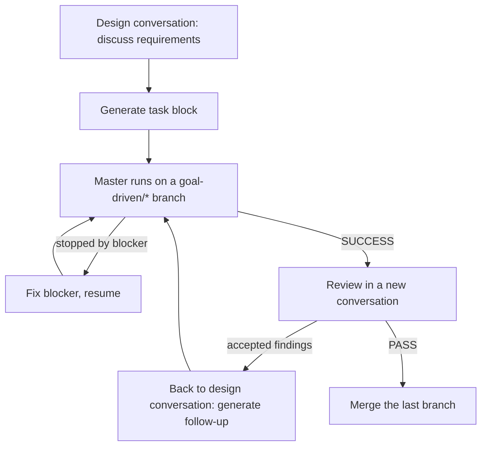

# goal-driven

English | [简体中文](README.zh-CN.md)

Prompts for running long, complex, objectively verifiable tasks with a Master Agent that keeps dispatching Workers until every success criterion is independently verified.

Inspired by [lidangzzz/goal-driven](https://github.com/lidangzzz/goal-driven).

```text
while (criteria not met)
{
    let the worker work on solving the problem and achieving the Goal
}
```

## Files

| File | Used by | Purpose |
|---|---|---|
| `Criteria Task Designer.md` | Your strongest chat model | Discuss requirements, generate the task, generate follow-up tasks |
| `Criteria Task Reviewer.md` | An agent with repository access, ideally a different model | Independently review a completed task |
| `Goal-Driven.md` | The Master Agent | Dispatch Workers, verify every Criterion, checkpoint, commit |

## Prerequisites

* The target project is a git repository.
* The selected Worker CLI is installed and works: `agy`, `pi`, or `agent` (cursor).
* The Master Agent has `Goal-Driven.md` loaded as its instructions.

## Workflow



### 1. Discuss and generate the task

Open a conversation with `Criteria Task Designer.md` as the prompt. Talk through requirements and fragmented ideas freely; the model tracks what is confirmed, revised, or dropped, and points out decisions that would change the Criteria.

When ready, ask it to generate the task. It outputs only:

```text
Goal: [[[[[ ... ]]]]]
Criteria for success: [[[[[ ... ]]]]]
Tool: [[[[[ agy | pi | cursor ]]]]]
```

Review the Criteria carefully. The Master runs until every Criterion passes, so a weak Criterion produces a wrong "success". Keep a copy of the block; you need it to resume and for review.

### 2. Prepare

* Check out the branch to start from, usually `main`.
* Uncommitted changes are allowed and protected as the baseline, but committing or cleaning them first is simpler.

### 3. Run the Master

Send the task block to the Master. It records the baseline, creates branch `goal-driven/<task-name>` and task directory `.git/goal-driven/<task-name>/`, then runs Worker rounds.

**Do not edit the workspace while it runs.** The Master would treat your edits as Worker changes.

Monitor progress with:

* `git log --oneline`: one checkpoint commit per verified round;
* `.git/goal-driven/<task-name>/state.md`: passed and unmet Criteria, failed approaches;
* `.git/goal-driven/<task-name>/logs/`: full Worker and verification output.

### 4. Interruptions and resume

The Master stops only on blockers no Worker round can fix: the Tool is unavailable, baseline changes are at risk, or a Criterion cannot be verified in the environment.

To resume after fixing the blocker, or after the Master session ends unexpectedly: stay on the task's `goal-driven/<task-name>` branch, start a new Master session, and send the **identical** task block. The Master continues from the last checkpoint. This also covers the Master stopping on a usage limit: it first makes sure no Worker from the previous session is still running, then inspects and verifies any unfinished round's changes before dispatching the next Worker.

### 5. Review in a new conversation

After `SUCCESS: ALL CRITERIA MET`, open a **new** conversation in an agent that can read the repository and run `git` (for example, Cursor), paste `Criteria Task Reviewer.md`, and give it the branch `goal-driven/<task-name>`. The reviewer reads `task.md` and `state.md` from the task directory and runs the diff itself, without modifying anything.

A separate reviewer prompt and conversation keep the review independent of the design discussion and save the design conversation's context. Using a different model than the designer reduces shared blind spots. If the reviewer has no repository access, provide the task block, `git diff <baseline>..goal-driven/<task-name>` (baseline HEAD from `state.md`), and `state.md` yourself; for a large diff, send `git diff --stat` first, then files on request.

The review outputs `VERDICT: PASS | FAIL` and findings labeled `[UNMET]`, `[NEW REQUIREMENT]`, or `[SUGGESTION]`. Suggestions are subjective; decide yourself.

### 6. Follow-up task

Paste the findings you accept back into the design conversation and ask for a follow-up task. It restates every Criterion from earlier tasks as non-regression criteria and tightens any Criterion that let an `[UNMET]` problem pass.

If you generate it in a new conversation instead, paste every earlier task block of the chain too.

Then stay on the previous `goal-driven/*` branch and send the follow-up block to the Master. When it asks whether to stack on that branch, choose stack. Repeat review and follow-up until the review passes.

### 7. Merge and clean up

The Master never merges. Merge the **last** branch of the chain; it contains every round:

```bash
git switch main
git merge --squash goal-driven/<last-task-name>
git commit -m "<description>"
git branch -D goal-driven/<task-name>    # each branch in the chain
```

Task directories under `.git/goal-driven/` are never deleted automatically; remove them when no longer needed.

If a baseline uncommitted change touches a file the task also changed, `git switch main` may refuse; resolve that change first.

## Task directory layout

```text
.git/goal-driven/<task-name>/
├── <baseline>      # HEAD, stash list, status, diff, original branch (named by the Master)
├── task.md         # verbatim task block
├── rules.md        # copy of Goal-Driven.md used by this task
├── state.md        # goal, status, checkpoints, Criteria, failed approaches
└── logs/
    ├── round-<N>-prompt.md     # this round's Worker Prompt
    ├── round-<N>-worker.pid    # Worker wrapper PID; mtime is the start time
    ├── round-<N>-worker.log    # raw Worker output (streamed events)
    ├── round-<N>-worker.exit   # Worker exit code, written only after exit
    ├── round-<N>-worker.progress  # workspace fingerprint, rewritten only on change; mtime is the last progress time
    └── round-<N>-verify.log
```

Everything lives inside `.git/`, so it is never tracked or committed. One branch maps to one task directory; a new Goal always gets a new one.

## Acknowledgments

This project is inspired by [lidangzzz/goal-driven](https://github.com/lidangzzz/goal-driven), which introduced the Goal-Driven approach: a Goal, strict Criteria for success, and a Master Agent that keeps a subagent working until the Criteria are met. Many thanks to its author for the idea.
