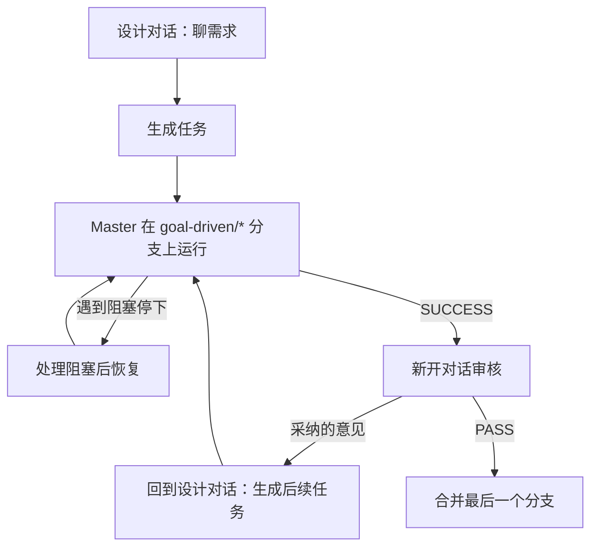

# goal-driven

[English](README.md) | 简体中文

一套提示词，用于执行耗时长、复杂、但成功与否可以客观验证的任务。Master Agent 不断派发 Worker，直到每一条成功标准都经过它的独立验证。

本项目受 [lidangzzz/goal-driven](https://github.com/lidangzzz/goal-driven) 启发。

```text
while (criteria not met)
{
    let the worker work on solving the problem and achieving the Goal
}
```

## 文件

| 文件 | 使用者 | 作用 |
|---|---|---|
| `Criteria Task Designer.md` | 你最强的对话模型 | 聊需求、生成任务、生成后续任务 |
| `Criteria Task Reviewer.md` | 能访问仓库的 Agent，最好与设计用的模型不同 | 独立审核已完成的任务 |
| `Goal-Driven.md` | Master Agent | 派发 Worker、验证每条 Criterion、存检查点、提交 |
| `scripts/` | Master Agent | 后台启动和轮询 Worker（`launch` / `poll`，分 `.sh` 和 `.ps1`） |

## 前置条件

* 目标项目是一个 git 仓库。
* `Goal-Driven.md` 顶部的 `Worker command` 和 `Worker report` 两行已设置好（见 [Worker 示例](#worker-示例)），且对应的 Worker 命令行工具已安装并能正常运行。
* Master 使用的 shell 是 bash（Linux/macOS）或 PowerShell 7（Windows）。macOS 上 `setsid` 需要从 util-linux 获取，`poll.sh` 里的 `stat -c %Y` 要换成 `stat -f %m`。
* `Goal-Driven.md` 顶部的 `Scripts directory` 一行已改成本仓库 `scripts/` 的绝对路径，且 Master 能读取该目录。
* Master Agent 已加载 `Goal-Driven.md` 作为指令。

## 工作流程



### 1. 聊需求，生成任务

用 `Criteria Task Designer.md` 作为提示词开一个对话。需求和零散的想法可以随便聊，模型会记录哪些已确认、哪些改过、哪些放弃了，并指出会影响 Criteria 的待定决定。

准备好后，让它生成任务。它只输出：

```text
Goal: [[[[[ ... ]]]]]
Criteria for success: [[[[[ ... ]]]]]
```

仔细检查 Criteria。Master 会一直跑到每条 Criterion 都通过为止，Criterion 写松了，它就会把错误的结果判为成功。把这两段文本留个底，恢复任务和审核时都要用。

### 2. 准备

* 切到要作为起点的分支，通常是 `main`。
* 可以有未提交的修改，Master 会把它们作为基线保护起来；但先提交或清理掉更省心。

### 3. 运行 Master

脚本不用你在消息里交给 Master。Master 从已加载的 `Goal-Driven.md` 顶部 `Scripts directory` 一行得知脚本位置，所以那一行必须是本仓库 `scripts/` 的绝对路径，例如 `E:/goal-driven/scripts`。

在目标项目的仓库根目录启动 Master 会话，确认它已加载 `Goal-Driven.md`，然后把两段文本发给它。派第一个 Worker 之前，它会：

1. 记录基线：HEAD、stash 列表、status、diff、原始分支；
2. 新建分支 `goal-driven/<任务名>` 和任务目录 `.git/goal-driven/<任务名>/`；
3. 在任务目录里保存 `task.md`（两段文本原文）和 `rules.md`（`Goal-Driven.md` 副本），并按自己的 shell 从 Scripts 目录复制 `launch` 和 `poll`（bash 用 `.sh`，PowerShell 7 用 `.ps1`）。读不到 Scripts 目录时，它会停下报告。

之后每一轮，Master 把 Worker Prompt 写入 `logs/round-<N>-prompt.md`，用复制来的 `launch` 在后台启动 Worker，用 `poll` 等它结束，再检查改动、验证每条 Criterion，合格的改动提交为检查点。

**运行期间不要修改工作区。** Master 会把你的改动当成 Worker 的改动处理。

查看进度：

* `git log --oneline`：某一轮留下了范围内的改动、且没有让已通过的 Criterion 退化时，会有一个检查点提交；所有 Criteria 通过后还有一个最终提交；
* `.git/goal-driven/<任务名>/state.md`：已通过和未通过的 Criteria、失败过的方案；
* `.git/goal-driven/<任务名>/logs/`：每轮 Worker 和验证的完整输出。

### 4. 中断与恢复

Master 只会因为 Worker 无法解决的外部阻塞而停下：Worker 命令或 Scripts 目录不可用、基线修改有丢失风险、某条 Criterion 在当前环境无法验证。没有进展不算停下的理由，Master 会换个方法继续。

处理完阻塞后，或者 Master 会话意外断开后：停在该任务的 `goal-driven/<任务名>` 分支上，新开 Master 会话，发送**一字不差**的两段文本。Master 会从最后一个检查点接着跑。Master 因额度用完而停掉也按这个方法恢复：它会先确认上一个会话留下的 Worker 已不在运行，再检查、验证未完成那一轮的改动，然后才派下一个 Worker。想换一个 Worker 接着跑，先改好 `Worker command` 和 `Worker report` 两行，恢复后的 Master 会用新的设置。

处理阻塞期间，不要在分支上提交、重置或切换分支，也不要在工作区留下改动：恢复时如果 HEAD 不是最后一个检查点，Master 会直接停下；未提交的非基线改动会被当成未完成那一轮 Worker 的改动处理。

### 5. 新开对话审核

Master 输出 `SUCCESS: ALL CRITERIA MET` 后，在能读取仓库、能运行 `git` 的 Agent（例如 Cursor）里**新开**一个对话，粘贴 `Criteria Task Reviewer.md`，并告诉它分支名 `goal-driven/<任务名>`。审核会自己读取任务目录里的 `task.md` 和 `state.md`，自己运行 diff，不修改任何内容。

独立的审核提示词和对话能让审核不受设计讨论的影响，也能节省设计对话的上下文。审核换一个和设计不同的模型，能减少两边盲点重合。如果审核无法访问仓库，就自己提供任务的两段文本、`git diff <基线>..goal-driven/<任务名>`（基线 HEAD 见 `state.md`）和 `state.md`；diff 太大时，先发 `git diff --stat`，再按它的要求逐个文件补充。

审核会输出 `VERDICT: PASS | FAIL`，以及标为 `[UNMET]`（确实没达标）、`[NEW REQUIREMENT]`（新的明确要求）、`[SUGGESTION]`（主观建议）的意见。主观建议由你自己取舍。

### 6. 后续任务

把你采纳的意见贴回设计对话，让它生成后续任务。后续任务会把之前所有任务的 Criteria 逐条写出来作为不能退化的条件，并把放过了 `[UNMET]` 问题的那条 Criterion 改得更严。

如果改在新对话里生成，要把这一串任务里之前每个任务的两段文本也贴进去。

然后停在上一个 `goal-driven/*` 分支上，把后续任务发给 Master。它问是否叠在这个分支上时，选叠加。重复审核和后续任务，直到审核通过。

### 7. 合并与清理

Master 不会替你合并。合并这一串任务中**最后一个**分支即可，它包含了所有轮次的改动：

```bash
git switch main
git merge --squash goal-driven/<最后一个任务名>
git commit -m "<描述>"
git branch -D goal-driven/<任务名>    # 这一串里的每个分支
```

`.git/goal-driven/` 下的任务目录不会自动删除，不再需要时手动删掉。

如果任务开始前留下的未提交修改，和任务改的是同一个文件，`git switch main` 可能会被拒绝，需要先处理掉那部分修改。

## Worker 示例

Master 使用哪个 Worker，由 `Goal-Driven.md` 顶部的 `Worker command` 和 `Worker report` 两行决定，任务文本不负责选择。要换命令行工具或模型，替换这两行即可。启动脚本会在命令末尾追加 `-p <提示词>`，所以该工具必须支持这种用法。输出要保持流式：日志不再增长时，`poll` 会把 Worker 视为空闲。

agy（默认）：

```text
Worker command: `agy --model gemini-3.8-flash --effort high --dangerously-skip-permissions --output-format stream-json`
Worker report: the last `{"event":"result"}` line; `result.status` and `result.response`.
```

pi：

```text
Worker command: `pi -a --model llama-local/qwen3.8-27b --mode json`
Worker report: the last `{"type":"turn_end"}` line; the text in `message.content`.
```

cursor：

```text
Worker command: `agent --model grok-4.7-xhigh --force --print --output-format stream-json`
Worker report: the last `{"type":"result"}` line; `is_error` and `result`.
```

## 任务目录结构

```text
.git/goal-driven/<任务名>/
├── <baseline>      # HEAD、stash 列表、status、diff、原始分支（文件名由 Master 决定）
├── task.md         # 一字不差的任务两段文本
├── rules.md        # 本任务使用的 Goal-Driven.md 副本
├── state.md        # 目标、状态、检查点、Criteria、失败过的方案
├── launch.* poll.*  # 按 Master 的 shell 从 scripts/ 复制的启动和轮询脚本（.sh 或 .ps1）
└── logs/
    ├── round-<N>-prompt.md     # 本轮 Worker Prompt
    ├── round-<N>-worker.pid    # Worker 包装进程 PID，修改时间即启动时间
    ├── round-<N>-worker.log    # Worker 原始输出（流式事件）
    ├── round-<N>-worker.exit   # Worker 退出码，仅在退出后写入
    ├── round-<N>-worker.progress  # 工作区指纹，仅在变化时重写，修改时间即最后进展时间
    └── round-<N>-verify.log
```

这些文件都在 `.git/` 里，不会被 git 追踪或提交。一个分支对应一个任务目录，新的 Goal 一定会用新目录。

## 致谢

本项目受 [lidangzzz/goal-driven](https://github.com/lidangzzz/goal-driven) 启发。该项目提出了 Goal-Driven 方法：一个目标（Goal）、一套严格的成功标准（Criteria），以及一个持续驱动子智能体工作、直到标准满足为止的 Master Agent。衷心感谢原作者的思路。
