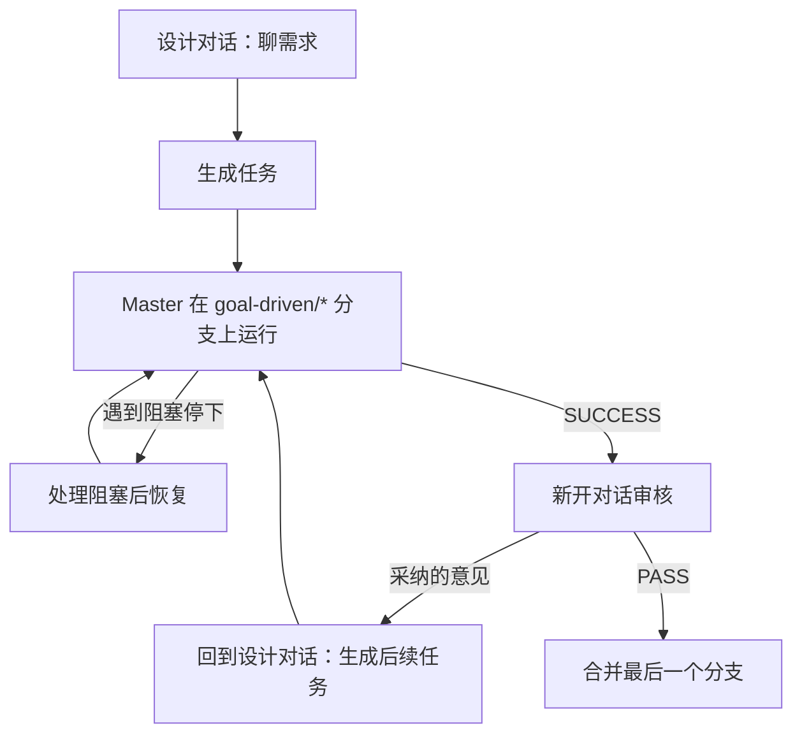

# goal-driven

[English](README.md) | 简体中文

一套提示词，用于执行耗时长、复杂、但成功与否可以客观验证的任务。Master Agent 不断派发 Worker，直到每一条成功标准都经过它的独立验证。

```text
while (criteria not met)
{
    let the worker work on solving the problem and achieving the Goal
}
```

## 文件

| 文件 | 使用者 | 作用 |
|---|---|---|
| `Criteria Task Designer.md` | 你最强的对话模型 | 聊需求、生成任务、审核结果、生成后续任务 |
| `Goal-Driven.md` | Master Agent | 派发 Worker、验证每条 Criterion、存检查点、提交 |

## 前置条件

* 目标项目是一个 git 仓库。
* 选定的 Worker 命令行工具已安装并能正常运行：`agy`、`pi` 或 `agent`（cursor）。
* Master Agent 已加载 `Goal-Driven.md` 作为指令。

## 工作流程



### 1. 聊需求，生成任务

用 `Criteria Task Designer.md` 作为提示词开一个对话。需求和零散的想法可以随便聊，模型会记录哪些已确认、哪些改过、哪些放弃了，并指出会影响 Criteria 的待定决定。

准备好后，让它生成任务。它只输出：

```text
Goal: [[[[[ ... ]]]]]
Criteria for success: [[[[[ ... ]]]]]
Tool: [[[[[ agy | pi | cursor ]]]]]
```

仔细检查 Criteria。Master 会一直跑到每条 Criterion 都通过为止，Criterion 写松了，它就会把错误的结果判为成功。把这三段文本留个底，恢复任务和审核时都要用。

### 2. 准备

* 切到要作为起点的分支，通常是 `main`。
* 可以有未提交的修改，Master 会把它们作为基线保护起来；但先提交或清理掉更省心。

### 3. 运行 Master

把三段文本发给 Master。它会记录基线，新建分支 `goal-driven/<任务名>` 和任务目录 `.git/goal-driven/<任务名>/`，然后开始逐轮派 Worker。

**运行期间不要修改工作区。** Master 会把你的改动当成 Worker 的改动处理。

查看进度：

* `git log --oneline`：每轮验收通过后会有一个检查点提交；
* `.git/goal-driven/<任务名>/state.md`：已通过和未通过的 Criteria、失败过的方案；
* `.git/goal-driven/<任务名>/logs/`：每轮 Worker 和验证的完整输出。

### 4. 中断与恢复

Master 只会因为 Worker 无法解决的外部阻塞而停下：工具不可用、基线修改有丢失风险、某条 Criterion 在当前环境无法验证。

处理完阻塞后，或者 Master 会话意外断开后：停在该任务的 `goal-driven/<任务名>` 分支上，新开 Master 会话，发送**一字不差**的三段文本。Master 会从最后一个检查点接着跑。

### 5. 新开对话审核

Master 输出 `SUCCESS: ALL CRITERIA MET` 后，用 `Criteria Task Designer.md` **新开**一个对话，提供：

* 任务的三段文本；
* `git diff <起点分支>...goal-driven/<任务名>`；
* `.git/goal-driven/<任务名>/state.md` 的内容。

新开对话能让审核不受设计讨论的影响，也能节省设计对话的上下文。diff 太大时，先发 `git diff --stat`，再按它的要求逐个文件补充。

审核会输出 `VERDICT: PASS | FAIL`，以及标为 `[UNMET]`（确实没达标）、`[NEW REQUIREMENT]`（新的明确要求）、`[SUGGESTION]`（主观建议）的意见。主观建议由你自己取舍。

### 6. 后续任务

把你采纳的意见贴回设计对话，让它生成后续任务。后续任务会把之前所有任务的 Criteria 逐条写出来作为不能退化的条件，并把放过了 `[UNMET]` 问题的那条 Criterion 改得更严。

如果改在新对话里生成，要把这一串任务里之前每个任务的三段文本也贴进去。

然后停在上一个 `goal-driven/*` 分支上，把后续任务发给 Master。它问是否叠在这个分支上时，选叠加。重复审核和后续任务，直到审核通过。

### 7. 合并与清理

Master 不会替你合并。合并这一串任务中**最后一个**分支即可，它包含了所有轮次的改动：

```bash
git switch main
git merge --squash goal-driven/<最后一个任务名>
git commit -m "<描述>"
git branch -D goal-driven/<任务名>    # 这一串里的每个分支
```

`.git/goal-driven/` 下的任务目录不会自动删除，不再需要时手动删掉。

如果任务开始前留下的未提交修改，和任务改的是同一个文件，`git switch main` 可能会被拒绝，需要先处理掉那部分修改。

## 任务目录结构

```text
.git/goal-driven/<任务名>/
├── <baseline>      # HEAD、stash 列表、status、diff、原始分支（文件名由 Master 决定）
├── rules.md        # 本任务使用的 Goal-Driven.md 副本
├── state.md        # 目标、状态、检查点、Criteria、失败过的方案
└── logs/
    ├── round-<N>-worker.log
    └── round-<N>-verify.log
```

这些文件都在 `.git/` 里，不会被 git 追踪或提交。一个分支对应一个任务目录，新的 Goal 一定会用新目录。
